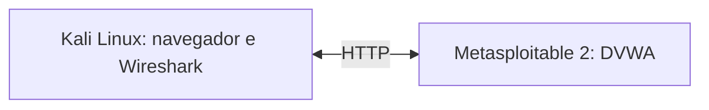

# Wireshark — HTTP Traffic Analysis Lab

## Objetivo
Demonstrar os riscos da transmissão de credenciais sem criptografia por meio da análise de tráfego HTTP em um laboratório virtual autorizado.

## Tecnologias utilizadas
- Oracle VM VirtualBox
- Kali Linux
- Metasploitable 2
- DVWA (Damn Vulnerable Web Application)
- Wireshark
- HTTP e TCP/IP

## Arquitetura

## Metodologia
1. Configuração do ambiente virtual.
2. Acesso ao DVWA pelo navegador do Kali Linux.
3. Captura e análise do tráfego HTTP com Wireshark.
4. Identificação de dados de autenticação transmitidos em texto claro.

## Demonstração prática
[Assistir ao vídeo](video/wireshark-http-credentials-capture.mp4)

## Resultados
A captura demonstrou a exposição de credenciais em comunicações HTTP sem criptografia. O laboratório analisa o tráfego do próprio cliente, não constituindo uma demonstração de ataque MITM.

## Recomendações de segurança
- Utilizar HTTPS com TLS e certificados válidos.
- Evitar a transmissão de credenciais por HTTP.
- Monitorar comunicações não criptografadas.
- Segmentar ambientes de testes.

## Competências desenvolvidas
Análise de pacotes, segurança de redes, fundamentos de TCP/IP, identificação de exposição de dados sensíveis e virtualização.

## Aviso ético
Projeto destinado exclusivamente a fins educacionais em ambiente autorizado. Utilize somente credenciais fictícias e mantenha sistemas vulneráveis isolados.
